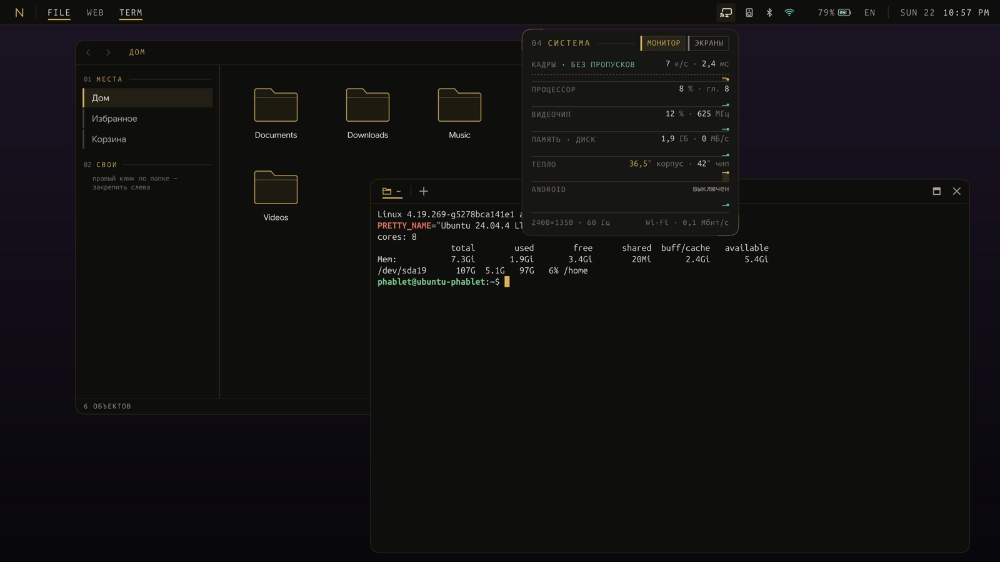
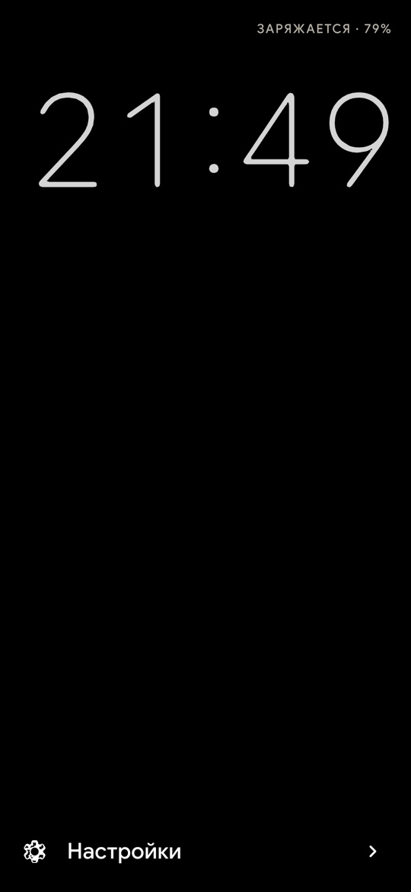
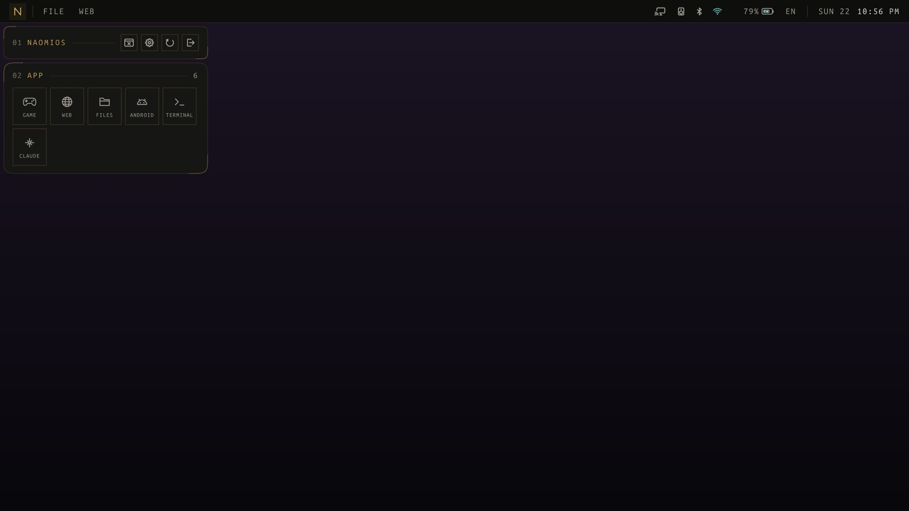

# PopkaPhone

**English** · [Русский](README.ru.md)

**A Linux phone that became a computer.** A from-scratch shell for the Google Pixel 5 (`redfin`) on top of Ubuntu
Touch 24.04: its own display driver, its own Wayland compositor, its own keyboard — and a windowed desktop that the
phone shows on a monitor, a MacBook, a tablet and a TV at the same time. The phone does all the work; the screens only
show the picture.

Written from scratch together with Claude (Claude Code). Inside the code and docs the project is called «НаомиФон» /
`naomi`.

Video: [25-minute walkthrough](https://www.youtube.com/watch?v=1gPjkVrjHgA) (in Russian) · Telegram: https://t.me/+Ekb7_o51208wNWE6

> **The project is frozen and published as is.** This is a snapshot of the working state on 22 November 2026: no
> history, no warranty, no support. Take whatever is useful — the license is MIT. Installing it **wipes the phone**;
> this is a test bench, not a daily driver.



**A note on language:** code comments, tool messages and the documents in `docs/` are in Russian. The commands
themselves are language-neutral; the quick start below is enough to install, and a translator handles the rest.

## What it does

- **Phone shell** on Qt Quick at 90 Hz: home screen, quick-settings shade, Settings with real device data, always-on
  display, its own RU/EN keyboard with typo correction ([SHELL](docs/SHELL.md), [DISPLAY](docs/DISPLAY.md),
  [KEYBOARD](docs/KEYBOARD.md)).
- **Desktop** in 16:9: panel, menu, windows, wallpaper, Files with quick look on Space, a browser (Qt WebEngine) with
  tabs in the panel, Terminal, system monitor, Internet, Bluetooth, sound and battery panels, Force Quit, screenshots
  ([DESKTOP](docs/DESKTOP.md), [FILES](docs/FILES.md), [WEB](docs/WEB.md), [TERMINAL](docs/TERMINAL.md)).
- **Screens:** the phone compresses the desktop with its hardware video encoder and sends it to a dock built on a
  Raspberry Pi 5 (HDMI monitor, keyboard, mouse, trackpad), a window on a Mac, an Android tablet and an Android TV — any
  set of them at once; it moves between cable and Wi-Fi without a break ([STREAM](docs/STREAM.md), [PI](docs/PI.md),
  [SCREENS](docs/SCREENS.md), [TABLET](docs/TABLET.md), [TV](docs/TV.md)).
- **Android apps** in desktop windows through Waydroid ([ANDROID](docs/ANDROID.md)).
- **Games:** NES and PlayStation (libretro cores), Windows programs and games through Wine + Box64 + DXVK + Turnip, a
  Bluetooth gamepad ([GAMES](docs/GAMES.md), [WINDOWS](docs/WINDOWS.md)). No games are included.
- **Claude Desktop for Linux** as a desktop window ([CLAUDE](docs/CLAUDE.md)); ESP32 boards plugged into the dock
  appear on the phone over USB/IP ([BOARDS](docs/BOARDS.md)).

Not in the public version: the author's chat and notes apps (they only worked with his home server) and his screen
editors. The documents still mention them — those are working notes.

| Phone home screen | Desktop menu |
|---|---|
|  |  |

The screenshots were taken on a freshly installed system, with no wallpaper and no personal data. The video shows it
in real use.

## Quick start

You need a Pixel 5 whose bootloader can be unlocked; a computer with `adb`, `fastboot`, `python3`, `curl`, `unzip`,
`zstd`, `ssh` (tested on macOS); for the desktop on a monitor — a Raspberry Pi 5, a microSD card and an HDMI monitor.

```sh
# 1. unlock the bootloader once, on stock Android (WIPES THE PHONE)
adb reboot bootloader && fastboot flashing unlock

# 2. download and verify the images: stock Android 13 (2.4 GB) and the Ubuntu Touch port (886 MB)
tools/images

# 3. flash (WIPES THE PHONE)
tools/flash.sh stock
tools/flash.sh ubuntu images/port-ci-16320685262/out

# 4. on the phone: finish the Ubuntu Touch wizard — connect Wi-Fi, set a passcode,
#    then System Settings → About → Developer mode

# 5. access: creates your own SSH key, then you type the phone passcode once
tools/naomi access
adb shell -t sudo sh /tmp/naomi-dev-access.sh

# 6. everything else in one command (about 15 minutes; the shell is built on the phone itself)
tools/naomi setup
```

Then, for the desktop on a monitor: `tools/pi-card diskN` (writes the Raspberry Pi card, macOS only), `tools/pi build`,
`tools/pi install`, `tools/pi fonts`, `tools/pi phone`. Optional parts: `tools/naomi android init`,
`tools/naomi cores`, `tools/naomi wine`, `tools/naomi claude install`. To go back: `tools/flash.sh stock`.

The full guide with sizes, checksums, what each step does and how to undo it is
**[docs/INSTALL.md](docs/INSTALL.md)** (Russian). This path was verified on 22 November 2026 on a wiped Pixel 5 from a
clean copy of this repository: stock image 99 s, Ubuntu Touch 59 s, `tools/naomi setup` 13 minutes. Not verified in
that run: writing the Pi card from scratch, the tablet and TV apps, Android, games and Wine on the fresh system.

There are no prebuilt binaries: everything is built from source by the commands above — the shell on the phone, the
receiver on the Pi, the Mac and Android apps on your computer.

## Under the hood

| | |
|---|---|
| Phone | Google Pixel 5 (`redfin`): Snapdragon 765G, 8 GB, 90 Hz OLED |
| Base | Ubuntu Touch 24.04 on Halium 13 (UBports, port [dadrickpistachio/google-redfin](https://gitlab.com/dadrickpistachio/google-redfin)) — the kernel and drivers come from there |
| Shell | Qt Quick 6.10, a display driver talking straight to HWC2, a Wayland compositor, the hardware service `naomid` |
| Desktop on screens | the phone's hardware encoder (H.264 / HEVC) → the `naomi-dock` receiver on the Pi (KMS), an Electron window on the Mac, a dependency-free Android app |

## Layout

| Folder | What |
|---|---|
| `shell/` | The shell: `display/` — display driver for Qt, `app/` — the shell-compositor and its QML (the desktop is in `qml/desktop/`), `ui/` — shared QML modules, `apps/` — the browser and the games program, `input/` — keyboard, `stream/` — streaming, `files/`, `term/`, `preview/`, `naomid/` — hardware service |
| `device/` | What runs on the phone: service installation, build environment, USB cable mode, Android, emulators, Wine, measurements and tests |
| `pi/` | The dock on a Raspberry Pi 5: the `naomi-dock` receiver, first boot, board sharing |
| `mirror/` | A window with the phone's screen on a Mac (Electron) |
| `tablet/` | The app for an Android tablet and Android TV (Java, no Gradle) |
| `tools/` | Commands run from the computer: `images`, `flash.sh`, `naomi`, `pi`, `pi-card`, `mirror`, `tablet`, `tv`, `boards`, measurements (`deskbench`, `xray`, `pi-smooth`, `kbtaps`) |
| `design/mockup/` | A web mockup in the spirit of Android 17 — a motion reference |
| `docs/` | Documents: how it works, measurements, what is verified and what is not |

## Documents

Working notes of the project, as they are: measurements on the phone itself, dates, and what did not work. In Russian.

| Document | About |
|---|---|
| [INSTALL](docs/INSTALL.md) | Installation from scratch and going back to Android |
| [DEVELOPMENT](docs/DEVELOPMENT.md) | Build environment on the phone; the cable: ADB and network over USB |
| [PHONE](docs/PHONE.md), [HWTEST](docs/HWTEST.md) | What is inside the phone and which hardware works |
| [DISPLAY](docs/DISPLAY.md) | The display without Lomiri: the frame's path through HWC2, 90 Hz |
| [SHELL](docs/SHELL.md), [UI](docs/UI.md), [KEYBOARD](docs/KEYBOARD.md) | Phone shell, interface, keyboard |
| [NAOMID](docs/NAOMID.md), [POWER](docs/POWER.md) | Hardware service; battery and sleep |
| [DESKTOP](docs/DESKTOP.md), [FILES](docs/FILES.md), [WEB](docs/WEB.md), [TERMINAL](docs/TERMINAL.md) | The desktop and its programs |
| [STREAM](docs/STREAM.md), [PI](docs/PI.md), [SCREENS](docs/SCREENS.md), [TABLET](docs/TABLET.md), [TV](docs/TV.md) | Streaming, the dock, multiple screens, tablet, TV |
| [ANDROID](docs/ANDROID.md), [ANDROID-AUDIT](docs/ANDROID-AUDIT.md) | Android apps on the desktop |
| [GAMES](docs/GAMES.md), [WINDOWS](docs/WINDOWS.md) | Console and Windows games |
| [CLAUDE](docs/CLAUDE.md), [BOARDS](docs/BOARDS.md) | Claude Desktop; ESP32 boards |
| [AUDIT](docs/AUDIT.md), [XRAY](docs/XRAY.md) | Top-down performance review; kernel tracing |
| [NOTHING](docs/NOTHING.md) | Scouting before a move to the Nothing Phone 1 |
| [ROADMAP](docs/ROADMAP.md), [CHANGELOG](CHANGELOG.md) | Plan and history |

## License

The project's own code is under [MIT](LICENSE): do whatever you want with it. Third-party components and their
licenses are listed in [THIRD-PARTY.md](THIRD-PARTY.md) (Russian). The repository contains no games, system images,
fonts or third-party programs — the scripts download them from their authors' sites.
